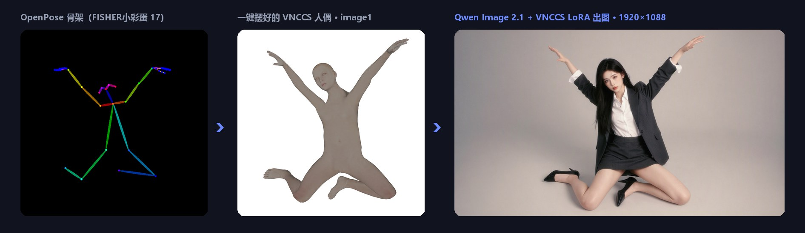
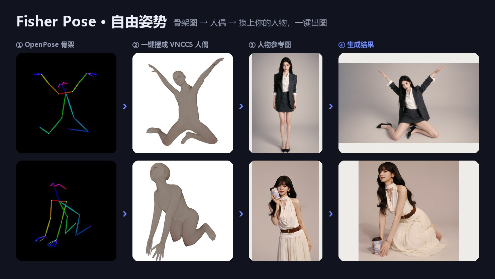
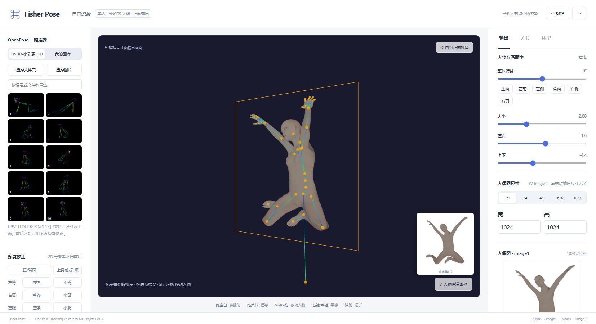

https://github.com/user-attachments/assets/24dc201a-d9dc-4ac7-86a8-acc9d8f6dd7c

# Fisher Pose · Camera & Pose

**A pose & camera editing plugin for Qwen Image 2.1: drag a 3D mannequin, or click an OpenPose skeleton image, and your character is redrawn in that pose.**

English · [中文](readme-cn.md) · [日本語](readme-jp.md)

> This is a multilingual fork of [Work-Fisher/ComfyUI-Fisher-Pose](https://github.com/Work-Fisher/ComfyUI-Fisher-Pose). The UI follows ComfyUI's language setting (Chinese / Japanese / English). The built-in skeleton images are not included (see [Installation](#installation)).

## What it does

| Mode | Node | In one sentence |
|---|---|---|
| **Free pose** | `Fisher Qwen2.1 Free Pose` | Any pose for one person: a realistic-proportion 3D mannequin + the VNCCS PoseStudio LoRA redraw the person from the reference image in the new pose |
| **Free view** | `Fisher Qwen2.1 Person & Pose Encode` | 1–3 people sharing one camera: move the camera, change positions and poses; Chinese edit instructions, optional PE (prompt enhancer) rewriting ([details, Chinese](docs/自由视角详细说明.md)) |

### Free-pose highlights

- **Realistic mannequin**: uses the MakeHuman mannequin from [VNCCS Pose Studio](https://github.com/AHEKOT/ComfyUI_VNCCS_Utils) — the same one the LoRA was trained with, so the model recognizes it.
- **One-click OpenPose**: click a colored skeleton image to apply the pose. A 2D skeleton has no front/back information, so depth is estimated from bone foreshortening; if a guess is wrong, the torso and each limb segment can be flipped front/back with one click.
- **Built-in skeletons (FISHER小彩蛋)**: 209 skeleton images covering standing, sitting, kneeling, squatting, lying, splits, mid-air and more. (Not included in this fork; copy them separately — see [Installation](#installation).)
- **My library**: skeleton images you choose once are kept and loaded automatically next time.
- **My poses**: save the whole pose with one click — body shape, proportions, framing and hands included — and restore it later from its thumbnail, even in another workflow. Poses are stored in `ComfyUI/user/default/fisher_pose/poses/`, one JSON file each, so you can share them.
- **Free-view editing, front output**: drag empty space to orbit, drag joints to pose (hands, feet and hips support IK), Shift+drag to move the person; the output always uses the VNCCS front camera.
- **Hand presets**: open, flat and fist, plus a grip slider.
- **Proportions**: head size, neck, shoulder width, torso, upper arm, forearm, thigh and shin can each be lengthened or shortened while the pose is kept.
- **Two independent sizes**: the mannequin image size is set in the editor; the output size comes from the node's width/height, so a resolution node can be connected.
- **Instant preview**: after “Apply to node”, the mannequin image appears on the node right away, without running the workflow.

## Results

The example character images are AI-generated. The mannequin image is image1, the person image is image2, and the prompt is fixed to `Draw character from image2`.

## Editor

- **Left**: built-in skeletons / My library, My poses, depth fix, hands.
- **Center**: 3D viewport. The orange frame is the output area; the small image at the bottom right is the actual front output.
- **Right**: size, position and turn of the person in the frame, mannequin image size, joint fine-tuning, body shape, head/neck/limb proportions.

## Installation

Copy (or clone) this plugin folder into `ComfyUI/custom_nodes`, then restart ComfyUI and reload the browser. No extra Python dependencies are needed; search for `Fisher` to find the nodes.

If you downloaded it from a cloud drive, make sure `web/vnccs/assets/` contains `pose_studio_makehuman.v2.bin` (about 86 MB); without it the editor cannot load the mannequin.

**Built-in skeleton images (not included in this fork):** copy `1.png`, `2.png`, … from the `FISHER小彩蛋/` folder of the original [Work-Fisher/ComfyUI-Fisher-Pose](https://github.com/Work-Fisher/ComfyUI-Fisher-Pose) repository (or from their provider) into this plugin's `pose-images/` folder. The images are git-ignored. Without them only the built-in list in the editor is empty. See [pose-images/README.md](pose-images/README.md).

**Models needed for free pose:**

| File | Put in | Notes |
|---|---|---|
| `qwen_image_2.1_*.safetensors` | `models/diffusion_models` | Qwen Image 2.1 main model |
| `qwen3vl_8b_*.safetensors` | `models/text_encoders` | type: `qwen_image` |
| `qwen_image_2.1_vae_*.safetensors` | `models/vae` | |
| `VNCCS_QI2_PoseStudioV1.1.safetensors` | `models/loras` | **Required**, strength 1. Download: [MIUProject/VNCCS_PoseStudio_QI2.1](https://huggingface.co/MIUProject/VNCCS_PoseStudio_QI2.1) |

ComfyUI must be a recent version that includes the `TextEncodeQwenImage21` node.

## Quick start (free pose)

1. Drag in `workflows/Fisher-Qwen2.1-自由姿势-VNCCS-LoRA.json` and choose your person photo in the “人物图 → image2” node.
2. Click **“Open free-pose editor”** on the node, then click a skeleton image in the built-in list on the left, or pose the joints yourself.
3. If needed, use “Depth fix” to flip front/back and adjust the hands and person size, then click **“Apply to node”**.
4. Set the output width/height and run. Recommended: 25 steps, cfg 1, euler / simple — the same as the official VNCCS settings.

> `extra_prompt` is appended on a new line after the fixed instruction; English is recommended, e.g. `soft studio light`.

## Where data is saved

Paths are relative to the top of the ComfyUI repository (defaults; `--user-directory`, `--input-directory` and `--temp-directory` change the `user`, `input` and `temp` parts).

| Data | Location | Notes |
|---|---|---|
| **My poses** (free-pose editor, “+ Save current pose”) | `user/default/fisher_pose/poses/<pose name>.json` | One JSON file per pose, including body shape, proportions, framing, hands and a thumbnail. Can be copied to other users. |
| **My library** (your OpenPose skeleton images) | `input/fisher_openpose/` | Copies uploaded through ComfyUI. “Clear” deletes these copies only; your original files are not touched. |
| **Built-in skeletons** | `custom_nodes/<this plugin>/pose-images/` | Read-only. Not included in this fork (see [Installation](#installation)). |
| **Pose / camera / people applied to a node** | Inside the workflow JSON (hidden `pose_json` / `scene_json` widgets) | Includes the mannequin image as base64 and the saved shots of the multi-person editor. Saved workflows go to `user/default/workflows/`. |
| **Node preview image** (shown right after “Apply to node”) | `temp/fisher_freepose_<hash>.png` | Temporary; may be removed when ComfyUI restarts. |
| **Multi-person editor opened standalone** (outside ComfyUI) | Browser localStorage (key `fisher-pose-multi-v2`) | Not used when the editor is opened from ComfyUI. |

## UI language

- The nodes and editors support Simplified Chinese, Japanese and English and follow ComfyUI's language setting (Settings → Comfy → Locale); other languages fall back to English.
- The Chinese edit instructions sent to the model, `Draw character from image2`, and the option values saved in workflows (output mode, prompt format, `自动` / `图1..3`) are unchanged, so existing workflows open as before.
- Error messages are in English.

## Acknowledgements

The free-pose mode is built on the following open-source work. Many thanks to the authors:

- **[VNCCS Utils](https://github.com/AHEKOT/ComfyUI_VNCCS_Utils) · [MiuProject / AHEKOT](https://github.com/AHEKOT)**: the Pose Studio mannequin core (`PoseViewerCore`, IK, capture), MakeHuman body pack loading, hand presets, and the **[VNCCS PoseStudio QI2.1 LoRA](https://huggingface.co/MIUProject/VNCCS_PoseStudio_QI2.1)** with its training convention (mannequin = image1, person = image2, `Draw character from image2`). Without this mannequin and LoRA there would be no free-pose mode. The code is distributed with this repository under the MIT license in `web/vnccs/`; see the README there for the changes. Consider starring the original repository.
- **[MakeHuman](http://www.makehumancommunity.org/)**: body mesh and shape data (CC0 1.0).
- **[Qwen Image 2.1](https://github.com/QwenLM/Qwen-Image-2.1)**: the image model, and the [prompt_rewrite](https://github.com/QwenLM/Qwen-Image-2.1/tree/main/prompt_rewrite) edit-instruction conventions (used by the free-view mode).
- **[three.js](https://threejs.org/)**: 3D rendering (MIT).
- **[ControlNet](https://github.com/lllyasviel/ControlNet)**: reference for OpenPose skeleton colors and connection order.
- **[ComfyUI-qwenmultiangle](https://github.com/jtydhr88/ComfyUI-qwenmultiangle)**: reference for view bins and camera vocabulary.
- **[ComfyUI](https://github.com/comfyanonymous/ComfyUI)**: the platform this plugin runs on.

## License

- Plugin code: [MIT](LICENSE).
- `web/vnccs/`: VNCCS Utils (MIT, © 2025 MiuProject); MakeHuman body pack (CC0 1.0); three.js (MIT).
- `web/editor/vendor/`: three.js (MIT).
- `system_prompt_edit.txt` (Qwen's PE system template from [Qwen Image 2.1 prompt_rewrite](https://github.com/QwenLM/Qwen-Image-2.1/blob/main/prompt_rewrite/prompts/system_prompt_edit.txt), Qwen Research License — non-commercial use only) is **not included** in this fork. To use Qwen's full template for PE rewriting in the free-view node, download it yourself, check its license, and place it in the plugin folder (it is git-ignored). Without it, the node uses a short built-in template.
- Follow the respective licenses of the LoRA and base models.

## Known limitations

- Free pose currently supports one person. If an OpenPose image contains several people, only the largest one is used.
- A 2D skeleton cannot uniquely determine front/back depth; complex poses need manual flips or fine-tuning. Head direction, fingers and feet are not read from the skeleton.
- The mannequin image provides the pose only. When the output aspect ratio differs greatly from the mannequin image, the person's placement in the frame is up to the model.

---

More: [Free-view mode details (Chinese)](docs/自由视角详细说明.md)
