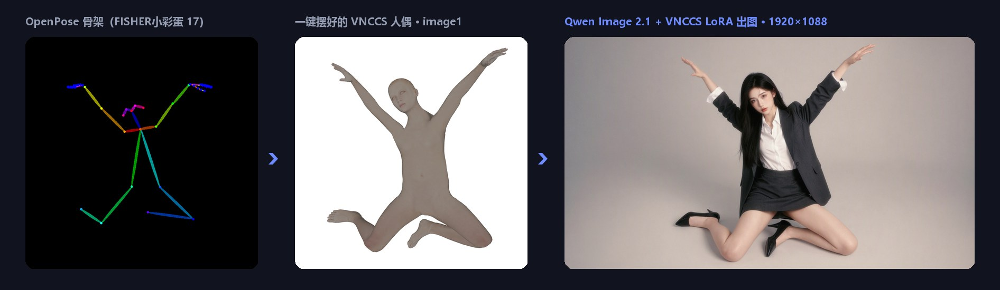
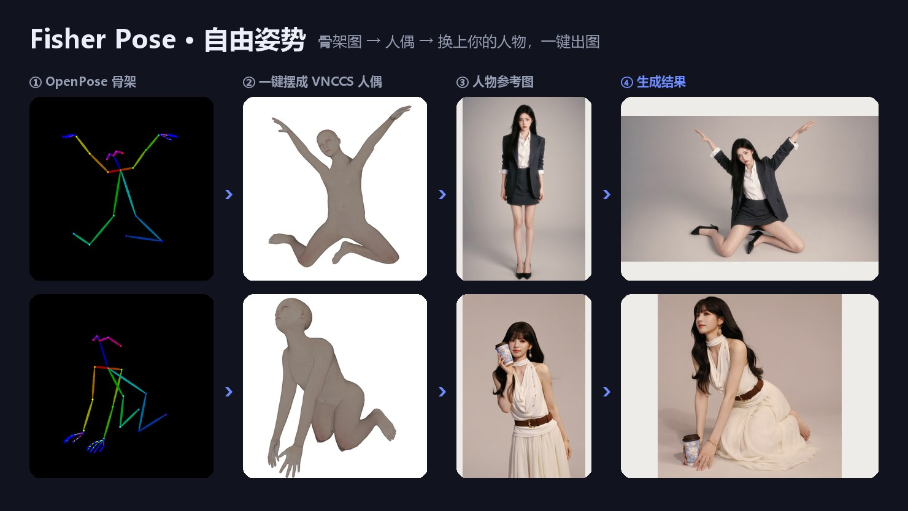
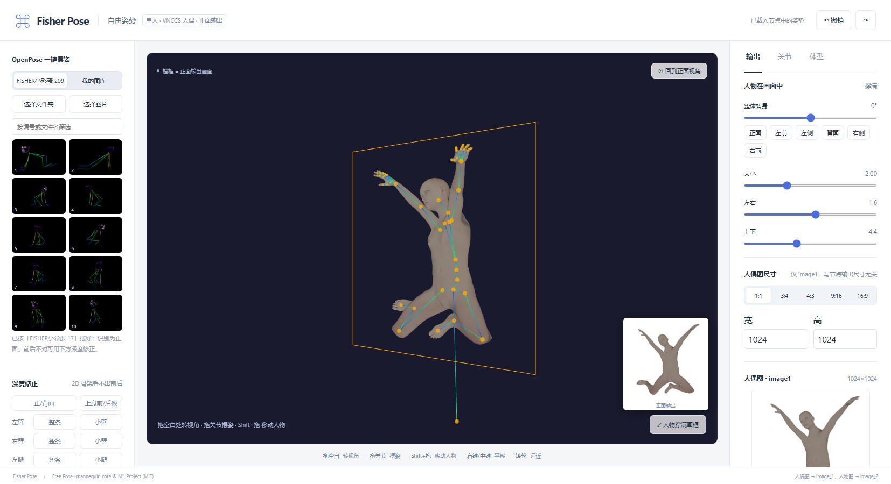

https://github.com/user-attachments/assets/24dc201a-d9dc-4ac7-86a8-acc9d8f6dd7c

# Fisher Pose · カメラとポーズ

**Qwen Image 2.1 向けのポーズ・カメラ編集プラグイン。3D マネキンをドラッグするか、OpenPose の骨格画像をクリックするだけで、人物をそのポーズで描き直せます。**

[English](README.md) · [中文](readme-cn.md) · 日本語

> このリポジトリは [Work-Fisher/ComfyUI-Fisher-Pose](https://github.com/Work-Fisher/ComfyUI-Fisher-Pose) の多言語化フォークです。UI は ComfyUI の言語設定（中国語 / 日本語 / 英語）に従って表示されます。内蔵の骨格画像は含めていません（「インストール」を参照）。

## できること

| モード | ノード | 概要 |
|---|---|---|
| **自由ポーズ** | `Fisher Qwen2.1 自由ポーズ` | 1 人を自由にポーズ付け。実際の人体比率の 3D マネキンと VNCCS PoseStudio LoRA で、参照画像の人物を新しいポーズで描き直します |
| **自由視点** | `Fisher Qwen2.1 人物＆ポーズ エンコード` | 1〜3 人が 1 台のカメラを共有。カメラの移動、立ち位置や動作の変更ができます。編集指示は中国語で、PE（プロンプト拡張）にも対応（[詳細・中国語](docs/自由视角详细说明.md)） |

### 自由ポーズの特長

- **実際の人体比率のマネキン**：[VNCCS Pose Studio](https://github.com/AHEKOT/ComfyUI_VNCCS_Utils) の MakeHuman マネキンを使います。LoRA の学習に使われたものと同じなので、モデルが正しく認識できます。
- **OpenPose ワンクリックポーズ**：カラーの骨格画像をクリックするだけでポーズが付きます。2D 骨格には前後の情報がないため、骨の見かけの短さから奥行きを推定します。推定が外れた場合は、胴体と手足の各部位をワンクリックで前後反転できます。
- **内蔵の骨格画像（FISHER小彩蛋）**：立つ・座る・ひざまずく・しゃがむ・寝る・開脚・空中など 209 枚。（このフォークには含めていないので、別途 `pose-images/` にコピーしてください。「インストール」を参照。）
- **マイライブラリ**：一度選んだ骨格画像は保存され、次回は自動で読み込まれます。
- **マイポーズ**：ポーズを体型・プロポーション・画面内の位置・手の形ごとワンクリックで保存し、次回はサムネイルから復元できます。別のワークフローでも使えます。`ComfyUI/user/default/fisher_pose/poses/` に 1 ポーズ 1 JSON ファイルで保存されるので、そのまま人に渡せます。
- **自由な視点で編集、正面で出力**：空白のドラッグで視点を回転、関節のドラッグでポーズ付け（手・足・腰は IK 対応）、Shift+ドラッグで人物を移動。出力は常に VNCCS の正面カメラです。
- **手の形のプリセット**：開く・揃える・握る、と握りの強さのスライダー。
- **プロポーション調整**：頭の大きさ、首、肩幅、胴、上腕、前腕、太もも、すねをそれぞれ伸縮できます。ポーズは保たれます。
- **2 つのサイズは独立**：マネキン画像のサイズはエディタで設定し、出力サイズはノードの width/height で決まります（解像度ノードを接続可）。
- **適用するとすぐプレビュー**：「ノードに適用」を押すと、ワークフローを実行しなくてもマネキン画像がすぐノードに表示されます。

## 生成例

例の人物画像は AI で生成したものです。マネキン画像が image1、人物画像が image2、プロンプトは `Draw character from image2` 固定です。

## エディタ

- **左**：内蔵の骨格画像 / マイライブラリ、マイポーズ、奥行きの修正、手の形。
- **中央**：3D ビュー。オレンジ枠が出力範囲で、右下の小さな画像が実際の正面出力です。
- **右**：画面内の人物の大きさ・位置・向き、マネキン画像のサイズ、関節の微調整、体型、頭・首・手足のプロポーション。

## インストール

このプラグインのフォルダを `ComfyUI/custom_nodes` にコピー（または clone）し、ComfyUI を再起動してブラウザを再読み込みしてください。追加の Python 依存パッケージは不要です。ノードは `Fisher` で検索できます。

クラウドドライブからダウンロードした場合は、`web/vnccs/assets/` に約 86MB の `pose_studio_makehuman.v2.bin` があることを確認してください。これがないとエディタでマネキンを読み込めません。

**内蔵の骨格画像（このフォークには含まれていません）：** 元リポジトリ [Work-Fisher/ComfyUI-Fisher-Pose](https://github.com/Work-Fisher/ComfyUI-Fisher-Pose) の `FISHER小彩蛋/` フォルダ（または提供元）から `1.png`、`2.png`… を、このプラグインの `pose-images/` フォルダにコピーしてください。画像は `.gitignore` で追跡対象外にしています。画像がなくても、エディタの内蔵リストが空になるだけです。詳しくは [pose-images/README.md](pose-images/README.md) を参照してください。

**自由ポーズに必要なモデル：**

| ファイル | 置き場所 | 説明 |
|---|---|---|
| `qwen_image_2.1_*.safetensors` | `models/diffusion_models` | Qwen Image 2.1 本体 |
| `qwen3vl_8b_*.safetensors` | `models/text_encoders` | 種類は `qwen_image` を選択 |
| `qwen_image_2.1_vae_*.safetensors` | `models/vae` | |
| `VNCCS_QI2_PoseStudioV1.1.safetensors` | `models/loras` | **必須**、強度 1。ダウンロード：[MIUProject/VNCCS_PoseStudio_QI2.1](https://huggingface.co/MIUProject/VNCCS_PoseStudio_QI2.1) |

ComfyUI は `TextEncodeQwenImage21` ノードを含む新しいバージョンが必要です。

## クイックスタート（自由ポーズ）

1. `workflows/Fisher-Qwen2.1-自由姿势-VNCCS-LoRA.json` をドラッグして読み込み、「人物图 → image2」ノードで人物の写真を選びます。
2. ノードの **「自由ポーズエディタを開く」** を押し、左の内蔵リストから骨格画像をクリックするか、関節をドラッグしてポーズを付けます。
3. 必要に応じて「奥行きの修正」で前後を反転し、手の形や人物の大きさを調整してから **「ノードに適用」** を押します。
4. 出力の幅と高さを設定して実行します。推奨設定：25 ステップ、cfg 1、euler / simple（VNCCS 公式と同じ）。

> `extra_prompt` は固定の指示文の後ろに改行して追加されます。英語での記入を推奨します（例：`soft studio light`）。

## データの保存先

パスは ComfyUI リポジトリのトップからの相対パスです（既定値。`--user-directory`、`--input-directory`、`--temp-directory` を指定した場合は、`user`、`input`、`temp` の部分がその指定先に変わります）。

| データ | 保存先 | 補足 |
|---|---|---|
| **マイポーズ**（自由ポーズエディタの「＋ 現在のポーズを保存」） | `user/default/fisher_pose/poses/<ポーズ名>.json` | 1 ポーズにつき JSON が 1 つ。体型、プロポーション、位置、手の形、サムネイルを含みます。そのまま人に渡せます。 |
| **マイライブラリ**（自分で選んだ OpenPose 骨格画像） | `input/fisher_openpose/` | ComfyUI の画像アップロード機能でコピーされたものです。「クリア」でこのコピーが消えます。元の画像は残ります。 |
| **内蔵の骨格画像** | `custom_nodes/<このプラグイン>/pose-images/` | 読み込み専用。このフォークには含めていません（「インストール」を参照）。 |
| **ノードに適用したポーズ・カメラ・人物の設定** | ワークフローの JSON の中（隠し項目 `pose_json` / `scene_json`） | マネキン画像（base64）と、複数人エディタの「ショットの保存」も含みます。保存したワークフローは `user/default/workflows/` に書き出されます。 |
| **ノード上のプレビュー画像**（「ノードに適用」直後に表示） | `temp/fisher_freepose_<ハッシュ>.png` | 一時ファイルです。ComfyUI を起動し直すと消えることがあります。 |
| **複数人エディタを ComfyUI の外で単体で開いたとき** | ブラウザの localStorage（キー `fisher-pose-multi-v2`） | ComfyUI 内で開いた場合は使いません。 |

## 表示言語

- ノードとエディタは簡体字中国語・日本語・英語に対応し、ComfyUI の言語設定（設定 → Comfy → Locale）に従って表示されます。その他の言語では英語になります。
- モデルに送る中国語の編集指示、`Draw character from image2`、ワークフローに保存される選択肢の値（出力モード、プロンプト形式、`自动` / `图1..3`）は変更していないので、既存のワークフローはそのまま開けます。
- エラーメッセージは英語です。

## 謝辞

自由ポーズモードは、次のオープンソースの成果の上に作られています。作者の皆さんに感謝します。

- **[VNCCS Utils](https://github.com/AHEKOT/ComfyUI_VNCCS_Utils) · [MiuProject / AHEKOT](https://github.com/AHEKOT)**：Pose Studio のマネキンのコア（`PoseViewerCore`、IK、キャプチャ）、MakeHuman 人体データの読み込み、手のプリセット、そして **[VNCCS PoseStudio QI2.1 LoRA](https://huggingface.co/MIUProject/VNCCS_PoseStudio_QI2.1)** とその学習時の約束（マネキン = image1、人物 = image2、`Draw character from image2`）。このマネキンと LoRA がなければ自由ポーズモードはありません。コードは MIT ライセンスで `web/vnccs/` に同梱しており、変更点は同フォルダの README にあります。ぜひ元リポジトリにスターを。
- **[MakeHuman](http://www.makehumancommunity.org/)**：人体メッシュと体型データ（CC0 1.0）。
- **[Qwen Image 2.1](https://github.com/QwenLM/Qwen-Image-2.1)**：画像生成モデルと、[prompt_rewrite](https://github.com/QwenLM/Qwen-Image-2.1/tree/main/prompt_rewrite) の編集指示の規約（自由視点モードで使用）。
- **[three.js](https://threejs.org/)**：3D 描画（MIT）。
- **[ControlNet](https://github.com/lllyasviel/ControlNet)**：OpenPose 骨格の配色と接続順の参考。
- **[ComfyUI-qwenmultiangle](https://github.com/jtydhr88/ComfyUI-qwenmultiangle)**：視点の区分とカメラ用語の参考。
- **[ComfyUI](https://github.com/comfyanonymous/ComfyUI)**：プラグインの動作基盤。

## ライセンス

- プラグインのコード：[MIT](LICENSE)。
- `web/vnccs/`：VNCCS Utils（MIT, © 2025 MiuProject）、MakeHuman 人体データ（CC0 1.0）、three.js（MIT）。
- `web/editor/vendor/`：three.js（MIT）。
- `system_prompt_edit.txt`（Qwen の PE 用システムテンプレート。[Qwen Image 2.1 prompt_rewrite](https://github.com/QwenLM/Qwen-Image-2.1/blob/main/prompt_rewrite/prompts/system_prompt_edit.txt) で公開、Qwen Research License で非商用のみ）は、**このフォークには含めていません**。自由視点ノードの PE 拡張で Qwen の完全なテンプレートを使う場合は、各自でダウンロードしてライセンスを確認のうえ、プラグインのフォルダに置いてください（`.gitignore` で追跡対象外）。ファイルがない場合は、内蔵の短いテンプレートを使います。
- LoRA とベースモデルは、それぞれのライセンスに従ってください。

## 既知の制限

- 自由ポーズは現在 1 人のみ対応です。OpenPose 画像に複数人いる場合は、最も大きく写っている人だけを使います。
- 2D 骨格からは前後の奥行きを一意に決められないため、複雑なポーズは手動での反転や微調整が必要です。頭の向き、指、足先は骨格から読み取りません。
- マネキン画像が決めるのはポーズだけです。出力の縦横比がマネキン画像と大きく違う場合、画面内の人物の位置はモデル次第になります。

---

詳細：[自由視点モードの詳しい説明（中国語）](docs/自由视角详细说明.md)
